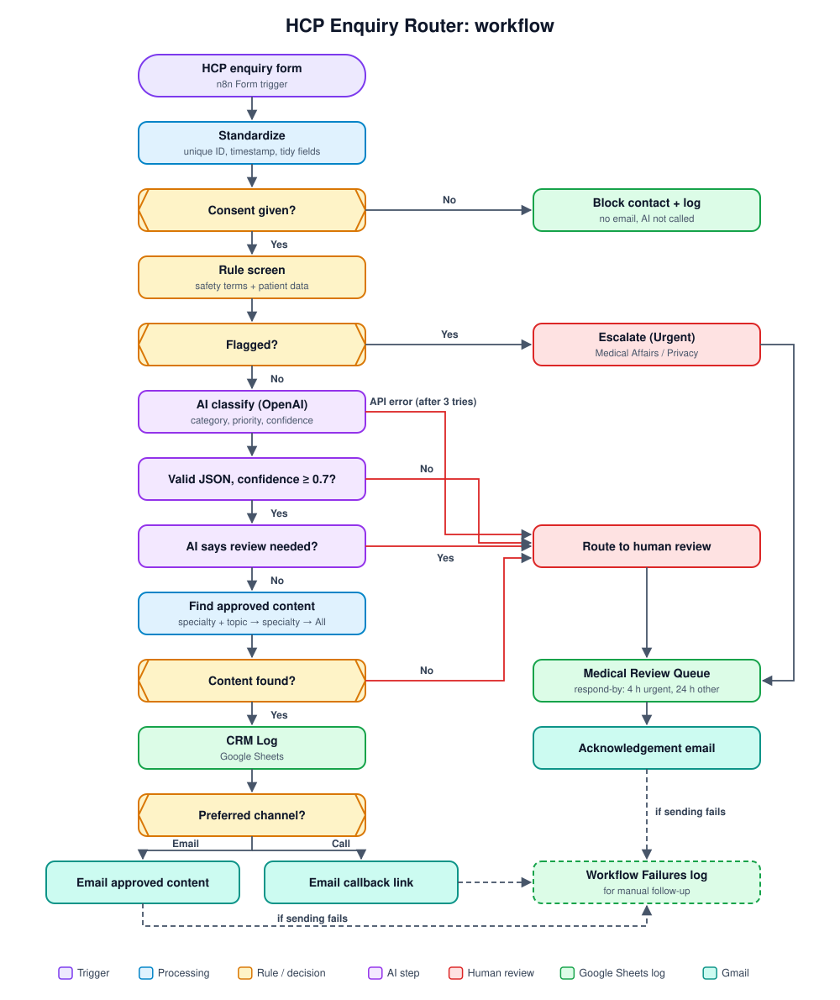

# HCP Enquiry Router: AI triage with compliance guardrails (n8n)

An **n8n** automation that triages enquiries from healthcare professionals (HCPs) for a precision-oncology diagnostics company. Each enquiry is checked for consent, safety and patient data, and **classified by AI**. It is then either answered with approved content, offered a callback, or sent to a human reviewer. Every step is logged to Google Sheets.

> ⚠️ **Prototype with sample data.** The company is fictional, the content links are placeholders, and no real HCP or patient data was used. Do not enter real patient information into the form.

**Tools:** n8n · OpenAI (GPT-4.1-mini) · Google Sheets · Gmail · JavaScript (Code nodes)

---

## The business problem

Pharma and diagnostics companies receive enquiries from doctors through webinars, conferences, emails and field representatives. Handling them by hand is slow. Handling them with AI alone is risky, because:

- a doctor may report a **side effect** (pharmacovigilance: a trained person must handle it),
- they may ask about **off-label use** (promotional rules forbid an automated answer),
- they may paste **patient details** into the form (a privacy risk),
- they may not have given **consent** to be contacted.

The goal is to let automation handle the routine enquiries quickly while sending every risky one to a person.

## How it works

### Design principles

1. **Rules before AI.** Consent and the safety/patient-data screen are plain rules that run *before* the AI. A risky enquiry never reaches the model.
2. **AI output is never trusted blindly.** The parser checks every field (category, priority, a true/false review flag, confidence). Anything malformed or below 70% confidence goes to a person.
3. **Fail safe.** If the AI service is down, or an email bounces, the enquiry is not lost. It goes to review or to the failures log.
4. **Approved content only.** The AI never writes medical content. Emails only link to items in a human-approved library.
5. **Audit trail.** Every path writes a row to a sheet, including blocked enquiries.

## Files

| File | What it is |
|---|---|
| `hcp-enquiry-router.json` | The n8n workflow (import into n8n) |
| `workflow-diagram.svg` | Diagram of the workflow shown above |
| `approved-content-library.csv` | Sample content library (one row is deliberately broken to test validation) |
| `test-enquiries.csv` | 9 test enquiries with the route each should take |

## Key features

| Feature | How it works |
|---|---|
| Consent check | No consent: nothing is sent and the AI is not called; the block is logged (without the query text) |
| Safety screen | Side effects, adverse events, off-label use, overdose, pregnancy and similar terms go straight to Medical Affairs as Urgent |
| Patient-data screen | Names with titles, dates of birth, ages, record numbers and phone numbers go to Privacy / Compliance |
| AI classification | The model returns category, priority, confidence and a reason as JSON; the query is passed as data, which protects against prompt injection |
| Output validation | Every AI field is checked; malformed output or confidence below 0.7 goes to human review |
| Fail-safe AI call | 3 retries; if the AI service still fails, the enquiry goes to human review instead of being lost |
| Content matching | Specialty + topic first, then specialty, then an "All" fallback; each item needs a title and a valid link |
| Next best action | Email preference: approved content is emailed. Representative Call: a callback-booking link is sent |
| Review deadlines | Review queue gets a `respond_by` time: 4 hours for Urgent, 24 hours otherwise |
| Failure logging | Any of the 3 emails failing is logged to "Workflow Failures" for manual follow-up |
| Unique IDs | Each enquiry gets a timestamp + execution-number reference, quoted in every email |

## Test results

I ran the Code-node logic (rule screen, AI-output parser, content matching, failure handlers) against `test-enquiries.csv`, with simulated AI answers:

| Test | Enquiry (short) | Route taken |
|---|---|---|
| T01 | Consent = No | Blocked and logged; no email; AI not called |
| T02 | "serious side effect after starting therapy" | Medical Affairs (Urgent) |
| T03 | "used off-label for a sarcoma case" | Medical Affairs (Urgent) |
| T04 | "Mrs. Sharma (DOB …)" | Privacy / Compliance Review |
| T05 | Tissue block requirements | Email: specimen checklist (specialty + topic match) |
| T06 | How to order a test, prefers a call | Email: callback-booking link |
| T07 | Intro material, Radiation Oncology | Email: falls back to the "All" library row |
| T08 | Prompt-injection attempt + lawsuit question | Human review |
| T09 | "asdf ??" | Human review (low confidence) |

The parser also correctly rejected: plain text instead of JSON, an unknown category, `"false"` as text instead of true/false, and an empty answer. "MS Word" and similar phrases are not flagged as patient names.

*These are logic tests outside n8n with simulated AI answers. The next step is to run the 9 enquiries through the live workflow and record what the real model returns.*

## Run it yourself

1. In n8n: **Workflows → Import from file** → choose `hcp-enquiry-router.json`.
2. Add credentials for **OpenAI**, **Google Sheets** and **Gmail**, and select them in the nodes.
3. Create one Google Sheet with these tabs and header rows:

| Tab | Header row |
|---|---|
| CRM Log | submission_id, received_at, HCP ID, HCP Name, Specialty, Organization, Email, Engagement Source, ai_category, ai_confidence, ai_reason, workflow_status, routing_team, priority, next_best_action, approved_content_title, approved_content_link, content_match, Preferred Channel |
| Medical Review Queue | submission_id, received_at, respond_by, HCP ID, HCP Name, Specialty, Email, workflow_status, routing_team, priority, reason, HCP Query, review_outcome, reviewed_by |
| Approved Content Library | Specialty, Topic, Content Title, Content Type, Approved Link (or import `approved-content-library.csv`) |
| Workflow Failures | submission_id, HCP Name, Email, workflow_status, failure_step, error_message, next_best_action |
| Blocked - No Consent | submission_id, received_at, HCP ID, Specialty, workflow_status, reason |

4. Replace `YOUR_GOOGLE_SHEET_ID` in the five Google Sheets nodes with your sheet's ID (the long code in its URL).
5. Replace the callback link in **Email Callback Link** with your own booking form.
6. Open the form URL and submit the enquiries from `test-enquiries.csv` using your own email address.

## Limitations and next steps

- **Keyword rules are a safety net, not a full pharmacovigilance system.** Unusual wording can slip past them, which is why the AI also flags safety topics and its prompt asks it to.
- **Measure the AI.** Build a set of about 50 labelled enquiries and record how often the AI's category and review flag match a person's judgement, especially how many risky enquiries it misses.
- Track reviewer outcomes (`review_outcome` column) to tune the rules and the confidence threshold.
- Add duplicate detection (same HCP, same question within 24 hours).
- Move from Google Sheets to a CRM (e.g. Salesforce or HubSpot) for real use.

## Disclaimer

A learning prototype built during my MBA at IIM Kozhikode. The company, content library and test enquiries are fictional, and the workflow is not validated for regulatory use. Any real deployment would need review by medical, legal, privacy and pharmacovigilance teams.

---
Built by **Anjali Bhushan** · [GitHub](https://github.com/anjali-bhushan)
